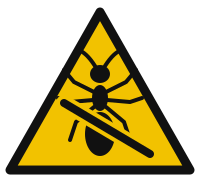

<p align="center"></p>

<h1 align="center">AntiStatic Recomp Toolkit</h1>
<p align="center"><b>Static recompilation of 32-bit Windows games to native code.</b><br>
x86 machine code in, portable C out, built and run natively on Linux or Windows.</p>

---

The AntiStatic Recomp Toolkit turns a 32-bit Windows game's program (a PE32 `.exe`, and the DLLs
that ship with it) into C source: one C function for every function in the program, at its
original address. That C is compiled together with a runtime that stands in for Win32 and
DirectX, and the game runs as a native program, with no emulator and no interpreter.

It has four parts:

- **A translator** (x86 to C) that finds every function in the program and writes it as C.
- **A Win32 runtime**: memory, files, threads, windows and messages, GDI, the registry, COM,
  the DLL loader, controllers, DirectInput, DirectSound, and stand-ins for Miles and DirectMusic.
- **Graphics**: Vulkan renderers for DirectDraw and Direct3D 6/7 (plus a software rasterizer for
  frame dumps), and a bridge from Direct3D 9 to DXVK's native build.
- **Checks**: the translator tested instruction by instruction against an emulator, A/B runs that
  compare a game's memory frame by frame, and tools for rewriting a game function by function as
  hand-written C.

AntiStatic is not related to the 2019 game *Antistatic*.

## What this repository never contains

No game files, no generated C, no game shaders or other extracted assets. The generated C is the
game's code in another form, so it is never shared. A port built with the toolkit translates
the player's own, legally owned copy on the player's own machine. `tools/audit_public.py` checks
the tree (and its git history) for program files, game assets and generated C before anything is
published.

## Quick start: the stub game

`tests/stubgame` is a small Windows program of our own (no game in it). Its test builds it as a
32-bit Windows program, translates it, compiles the C with the runtime, runs it headless and
checks the result, the rewrite tools and the register audit.

You need:

- Linux on x86-64, with gcc, binutils and make
- [Zig](https://ziglang.org/) 0.13 or later (`zig cc` builds the 32-bit Windows program; a mingw
  i686 gcc works too, with `CC_WIN` and `DLLTOOL`)
- an SDL3 build (`include/`, `lib/libSDL3.a`)
- FFmpeg's development libraries (libavformat, libavcodec, libswresample, libavutil) and zlib
- Python 3 with `capstone` (and `unicorn` for the self-test)

```bash
ZIG=/path/to/zig SDL3=/path/to/sdl3 PYTHON=python3 tests/stubgame/run.sh
```

Each check prints a line ending in `ok`; the script exits non-zero if any fails.

The translator's self-test runs hand-written x86 test functions on random inputs, once in the
[Unicorn](https://www.unicorn-engine.org/) emulator and once translated, and compares them:

```bash
python3 tests/selftest/run.py        # or: make selftest
```

To translate a program you own, write a build config that names its files
([docs/BUILD-CONFIG.md](docs/BUILD-CONFIG.md)) and run:

```bash
python3 translator/recomp.py path/to/game builds/mygame.py gen
```

Then follow [docs/GUIDE.md](docs/GUIDE.md) from there to a native port.

## How it works

```
 your game's .exe/.dll ──► translator/recomp.py ──► gen/*.c ──┐
                                                               ├──► native game
 the runtime (Win32 + DirectX stand-ins, Vulkan) + your port ──┘
```

1. **Discovery** follows the program from its entry points, exports, exception tables and the
   code addresses it holds in data, and works out each function's extent, jump tables and tail
   calls.
2. **Code generation** writes each function as C: registers become locals, memory is the
   program's own addresses, calls between functions are C calls, and flags are computed only
   where a later instruction reads them. Integer, x87, MMX and SSE instructions are covered; x87
   arithmetic runs on the host's x87 under the game's control word.
3. **The runtime** maps the program where Windows would, answers its imports (a call to
   `CreateFileA` is a C function), and draws through Vulkan.
4. **A port** is the game-specific part: a `port.h` describing the game
   (`runtime/win32/port_example.h`), its build config, and any hooks (widescreen, menus,
   controller support, rewrites).

## Layout

| Path | What it holds |
| --- | --- |
| `translator/` | The x86 to C translator: PE reading, discovery, code generation, C++ exception tables, SIMD, and `memdiff.py` for comparing memory dumps. |
| `runtime/cpu/` | The CPU record and memory access the generated C uses, and the x87 helpers. |
| `runtime/win32/` | The Win32 stand-in, controllers, DirectInput, DirectSound, the frame pacer, and `port_example.h`. |
| `runtime/win/` | What the runtime needs to build as a 64-bit Windows program ([its README](runtime/win/README.md)). |
| `runtime/d3d7/` | DirectDraw and Direct3D 6/7 on Vulkan, and a software rasterizer ([its README](runtime/d3d7/README.md)). |
| `runtime/d3d9/` | Direct3D 9 through DXVK's native build ([its README](runtime/d3d9/README.md)). |
| `runtime/music/` | Stand-ins for the Miles Sound System, DirectMusic and FMOD ([its README](runtime/music/README.md)). |
| `runtime/rewrite/` | Support for rewriting functions as hand-written C: the per-function check, the register audit, coverage builds. |
| `tools/rewrite/` | The A/B check (`ab.sh`), bisecting, class and module maps, progress reports. |
| `tools/coverage/` | How much of a program discovery found, scored against a PDB, a linker map or another tool's function list. |
| `tools/d3d9/` | DXVK build script and Direct3D 9 code generators. |
| `tools/win/` | Wrappers that use Zig to build the Windows programs. |
| `tools/audit_public.py` | The publishing check described above. |
| `tests/` | The self-test, the stub game, controller and frame-pacing tests, the file-mask test. |
| `third_party/` | DXVK patches, GothicKit's DirectMusic, stb_vorbis. |
| `docs/` | The guides listed below. |

## Documentation

- [docs/GUIDE.md](docs/GUIDE.md): taking a Win32 game from its `.exe` to a native port.
- [docs/BUILD-CONFIG.md](docs/BUILD-CONFIG.md): the build config file the translator reads.
- [docs/MOVING.md](docs/MOVING.md): moving a port that has its own copies of the translator and
  runtime onto the toolkit.
- [docs/REWRITE.md](docs/REWRITE.md): rewriting a game function by function as readable C, and
  checking each rewrite.
- [CHANGELOG.md](CHANGELOG.md): every version, and which ones change the generated C (a port
  translates its game again when they do).
- [CONTRIBUTING.md](CONTRIBUTING.md): issues, pull requests and the checks they must pass.

## Versions

Versions are git tags (`v0.1.0`, ...). A port pins one version, usually as a git submodule, and
moves up when it chooses to, then runs its own checks again.

## Ports built on it

LEGO Island 2, LEGO Island Xtreme Stunts, Test Drive 6, Test Drive Off-Road 3, Off-Road, Hard
Truck 2, 1NSANE, Penguins!, Enter the Matrix, Stranglehold, Nitronic Rush, L.A. Rush.

## Credits

The toolkit grew out of those ports. It borrows from other projects, each credited in
[NOTICE](NOTICE) and in the files that use them:

- [pcrecomp](https://github.com/sp00nznet/pcrecomp) by sp00nz (MIT): the function-discovery
  scorer and its PDB and linker-map readers (`tools/coverage/`), its lifter test cases
  (`tests/selftest/pcrecomp_cases.*`), and the idea of the repository audit.
- [SwARc](https://github.com/JTM-rootstorm/SwARc) (MIT): Windows' file-mask matching
  (`runtime/win32/dosmask.h`), and the ideas behind the x87 tests under every control word, the
  frame pacer and several thread and handle fixes.
- [recomp-kit](https://github.com/veritr1x/recomp-kit) by veritr1x (MIT): the idea of a stub game
  that tests the toolkit with no game files, and of the clock-spin guard.
- [DXVK](https://github.com/doitsujin/dxvk) by Philip Rebohle and contributors (zlib/libpng; its
  dxbc-spirv subproject MIT): the Direct3D 9 bridge builds on it, and `third_party/dxvk` holds our
  patches to it. DXVK's source is not included.
- [GothicKit's DirectMusic](https://github.com/GothicKit/dmusic) (MIT) with
  [TinySoundFont](https://github.com/schellingb/TinySoundFont) (MIT), in `third_party/dmusic`.
- [stb_vorbis](https://github.com/nothings/stb) by Sean Barrett (public domain or MIT), in
  `third_party/stb_vorbis`.
- [Unicorn](https://www.unicorn-engine.org/) and [Capstone](https://www.capstone-engine.org/),
  used by the tests and the translator (not included).

## Licence

The toolkit's own code is released into the public domain under [the Unlicense](LICENSE).
Borrowed parts keep their own licences, listed in [NOTICE](NOTICE).

Maintained by [AntAir267](https://github.com/AntAir267). The games remain their owners'
property; use the toolkit only with copies you own.
